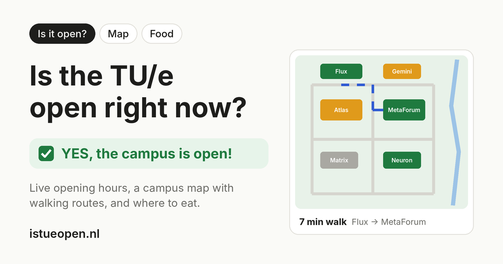

# Is the TU/e open?

**[istueopen.nl](https://istueopen.nl)** · [Nederlands](https://istueopen.nl/nl/)

A quick way to see which buildings, study spots and places to eat on the TU/e campus in Eindhoven are open right now.



> This is an unofficial student project and is not affiliated with TU/e. The hours are taken from the [TU/e website](https://www.tue.nl/en/our-university/tue-campus/buildings/opening-hours-buildings) and checked every week, but always check the official pages when it really matters.

## Features

- **Open right now:** a clear yes or no for the whole campus, with a warning when a building is about to close
- **Every building, the library and the Sports Centre,** with today's hours and the hours for the week
- **Food:** all canteens, cafés and restaurants on campus
- **Campus map** with building outlines and walking routes between buildings
- **Pins:** keep the buildings you use most at the top, and share a link to one building
- **Study spots, exam countdown and rain warning**
- **Holidays:** automatic warnings on Dutch public holidays and TU/e bridge days
- **Report form** for wrong hours or mistakes on the map
- **English and Dutch,** light and dark mode, works offline and can be added to your home screen

## How it works

It's a plain static site: HTML, CSS and JavaScript, with no framework and no build step. All opening hours live in one file, [`js/hours.js`](js/hours.js), and the pages work out in the browser what's open, using Dutch time. Public holidays such as Easter and King's Day are calculated, so they don't need updating every year.

```
index.html, food.html, map.html,     the English pages
report.html, privacy.html
nl/                                  the Dutch pages
js/hours.js                          all opening hours, exam periods and special days
js/open.js                           what's open, the lists, pins and holidays
js/map.js                            campus map and walking routes
js/site.js                           theme, language and offline support
css/style.css                        the design
img/                                 icons and preview images
sw.js                                offline support
admin.html                           private page for reading reports
```

## Running it locally

```
git clone https://github.com/tiesjjanssen07/istueopen.git
cd istueopen
python3 -m http.server
```

Then open http://localhost:8000.

## Built with

- [Leaflet](https://leafletjs.com) and [OpenStreetMap](https://www.openstreetmap.org/copyright) for the map
- [OSRM](https://routing.openstreetmap.de) for walking routes
- [Open-Meteo](https://open-meteo.com) for the rain forecast
- [Firebase](https://firebase.google.com) for the report form
- [GoatCounter](https://www.goatcounter.com) for privacy-friendly visit counts, without cookies
- Hosted on [GitHub Pages](https://pages.github.com)

## Spotted a mistake?

Use the [report form](https://istueopen.nl/report) on the site, or open an issue here.
